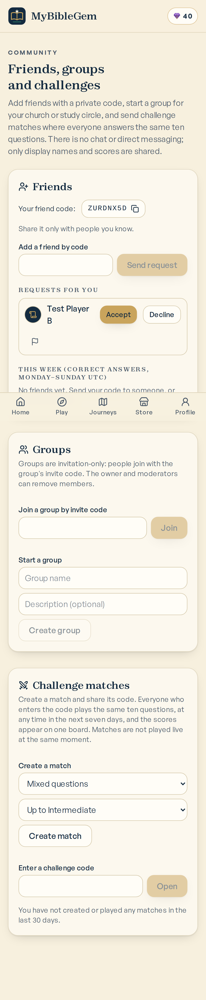
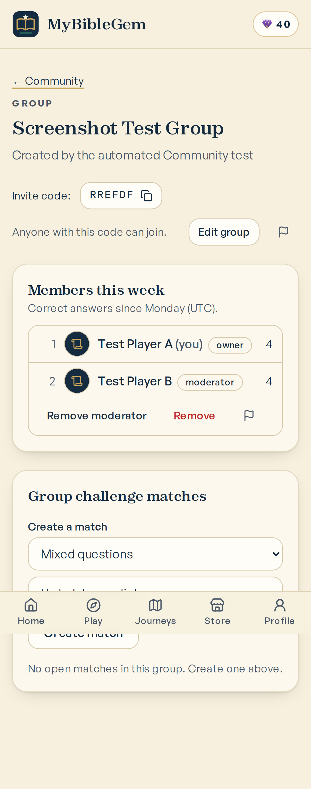
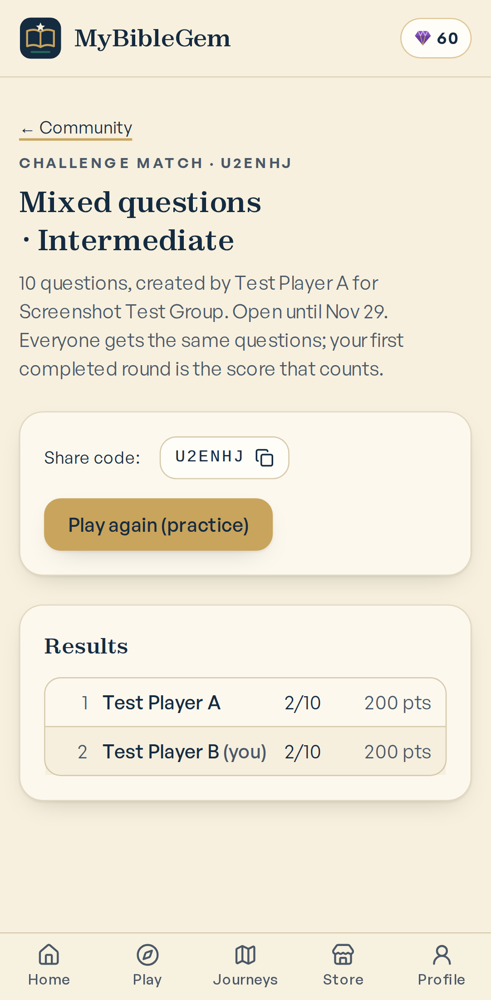
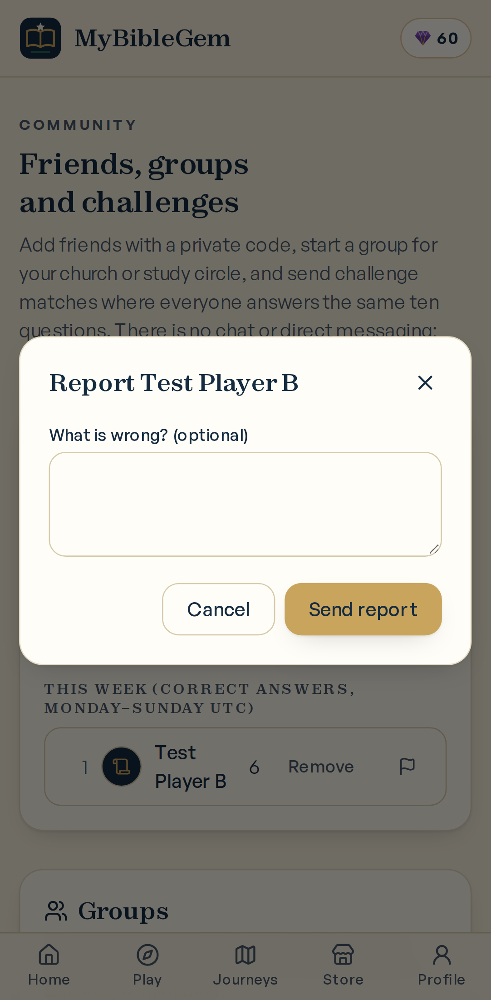

# Development status report

Date: 16 November 2026 · Version 1.0.0-preview.3 (updated 21 November 2026)

Status labels:

- **Tested**: automated tests ran and passed in this build environment.
- **Built**: code exists, compiles and renders, but has not been run against a live Supabase project.
- **Pending**: not built yet.
- **Blocked**: needs a decision, account or permission from the project owner.

## Test results (this build)

| Suite | Command | Result |
|---|---|---|
| Unit: game rules, rewards, store, power-ups, adaptive difficulty | `npm test` | 18 / 18 passed |
| Database integration: real migrations, seed and RLS on PostgreSQL 18 (embedded), with a stub of Supabase's `auth` schema | `npm run test:db` | 54 / 54 passed (includes Old/New Testament filtering and separate level bonuses) |
| Browser (desktop Chrome and Pixel 7): full level, gems persist, replay earns nothing, hint purchase, dark mode and text size, locked content, answer sounds, plus the new KJV verse after answers, read-aloud, vibration, share, streak card and calendar, review-my-mistakes, Privacy and Terms | `npm run test:e2e` | all 76 passed, including the new testament test (one run hit a trace-file clash in a single test; it passed on rerun) |
| Accessibility: axe WCAG 2.0/2.1/2.2 A + AA rules on 14 routes (now including Privacy and Terms) × light/dark × desktop/mobile | `npm run test:e2e` | included in the 76 |
| Live gameplay against the real Supabase project (`tests/live/gameplay.spec.ts`) | `npx playwright test -c playwright.live.config.ts tests/live/gameplay.spec.ts` | 1 / 1 passed |
| Production build, and a check that the online build excludes the answer key | `npm run build` | Passed |
| Hosted preview: full level played, no page errors | manual Playwright run | Passed |
| Community with two registered accounts on https://mybiblegem.com (`tests/e2e/community-live.spec.ts`, Pixel 7) | see "Community screenshot test" below | 1 / 1 passed, 14 screenshots, no page errors (22 Nov 2026) |

The database tests use a stand-in for Supabase's `auth` schema (`supabase/tests/supabase_auth_stub.sql`). They prove the SQL rules, but not Supabase's own Auth service.

## Completed and tested

- Five full game modes plus two challenge modes:
  - Picture Bible Quiz, Who Am I? (progressive clues and scoring), Scripture Challenge, Story Sequencing (accessible move buttons) and Bible Adventure Journey (2 journeys, 12 chapters, unlocked in order).
  - Daily Bible Challenge and Challenge Arena (optional 20-second timer; Expert arena unlocked by a store bonus).
- Four difficulties, chosen by the player. Adaptive suggestion: 85%+ accuracy moves up, under 50% moves down.
- 324 questions (picture 92, Who Am I 52, scripture 153, sequencing 27). Every reference was automatically checked against the KJV text.
- Gem rules, enforced server-side in SQL and mirrored in the preview:
  - 10 for a correct answer (first time per question only), 50 per level, 100 for a perfect round, 25 daily, 250 per adventure, each once.
  - No negative balances. Idempotent purchases. Power-ups are used up once per question.
  - Full transaction history.
- Store: 29 items (power-ups, badges, frames, colour themes, galleries, collectibles, decorations, bonus challenge). Purchases need confirmation; the store shows owned status, inventory, equipping and history.
- Row-level security: players read only their own data. All writes go through database functions. Only published content is visible.
- Editorial workflow in the database: draft → review → approved → published, publishing for admins only, reference-validation trigger, audit log.
- Responsive design in the brand palette; light, dark and high-contrast; text sizes; reduced motion; keyboard play; mobile tab bar.
- Answer sounds: a mini brass fanfare ("ta-DA": a G4 pickup into a C major chord) for correct, chosen by the owner on 17 November from nine options, a soft low tone for incorrect, and a short arpeggio when a round ends. They are generated in the browser (no audio files or licences), can be set to Off, Soft or Normal in Settings, and are never the only signal. Not yet checked by ear on a physical phone.
- PWA: manifest, icons, offline app shell (service worker registration checked locally).
- Gameplay upgrades (16 November):
  - After every answer, the KJV verse is shown (up to 6 verses), with a "Read aloud" button. Story Sequencing shows a short verse line per event.
  - Read question aloud, optional automatic reading and reading speed, using the device's built-in voice.
  - Vibration on right/wrong answers and at round end (can be turned off).
  - Share result: score pattern (■□) and the site address, never the answers. Falls back to copying; shows a note if neither is available.
  - Review my mistakes: replays questions you got wrong until you get them right (server-side in online mode).
  - Daily streaks: 7-day card on Home, month calendar on Profile, current and best streak, using the player's time zone.
- Privacy policy and Terms of use pages (`/privacy`, `/terms`), linked from the footer, Settings, About, Profile and the sign-up form. Plain-language drafts, not legal advice. The contact address comes from `VITE_CONTACT_EMAIL`, which is not set yet.
- Delete my account (online mode, Profile): type DELETE to confirm. It removes the player's data; content they edited as staff is kept.
- Spacing artifacts from the KJV source ("LORD ,") are cleaned in prompts and verses (14 prompts changed; answers unchanged).

## Live Supabase project (16 November 2026)

- Project `biblequest` (ref `zosmfpridatotdrvbqrx`) was created in a new **Free** organization called "BibleQuest". The LearningGem organization and project were not touched.
- Both setup scripts ran on it: 28 tables, all with row-level security, 324 questions (0 published), 29 store items, 12 chapters and 12 achievements.
- Fixed while loading: the `story_sequences` table was missing from the row-level-security list. It is now locked in the live database, `supabase/setup/1_database.sql` and the migration.
- Auth: anonymous guest sign-ins are on; email sign-up with email confirmation is on. The Site URL is still `http://localhost:3000` and must be changed to the real address once the site is hosted.
- **Tested live** (`tests/live`, Playwright desktop Chrome against a local server of the online build): a guest played a full 8-question level and earned 80 gems, which survived a reload. The guest added an email and kept the gems, set a password and bought a 30-gem hint. A second, fresh browser then signed in with that email and password and showed 50 gems. Database check: balance 50, 5 ledger entries, hint ×1 in inventory.
- For that test only, email confirmation was switched off and 8 picture questions were published. Both were reverted afterwards, and the test accounts were deleted.
- Not yet tested: the real confirmation and password-reset emails, phones, and a hosted address. Supabase's built-in email sender is limited to 2 emails per hour; add custom SMTP before launch. (22 Nov 2026: email confirmation was switched off so sign-up no longer depends on email; password-reset emails still use the limited sender.) CAPTCHA is not enabled.

### Security and performance hardening (applied live 16 November)

- Migrations `20261116000005_hardening_and_gameplay.sql` and `20261116000006_merge_read_policies.sql` were run on the live project, and verse text was added to all 324 questions.
- Role checks moved to a private schema. Every policy was rewritten to name its roles and evaluate the user once per query. A bug in the groups policy was fixed. The `published_questions` view no longer bypasses security, and a counts function replaces it for visitors. All 20 foreign keys are indexed. Deleting a user no longer fails because of content they edited.
- Auth: minimum password length raised from 6 to 8 (the app already required 8). Localhost addresses were added to the redirect allow list. The Site URL is still `http://localhost:3000`.
- The project is hosted in AWS us-east-2 (Ohio, United States), as the Privacy page says.
- Supabase advisors after the change:
  - Security: the earlier ERROR (security-definer view) is gone.
  - Remaining warnings are by design: anonymous guest sign-ins; game and admin functions callable by signed-in users (each checks permissions inside); the leaderboard and question-count functions are public; `story_sequences` is locked with no policy (answers are read only inside functions).
  - Performance: the 15 per-row auth warnings, 20 unindexed foreign keys and duplicate read policies are gone. What remains is 22 "unused index" notes, which is expected with no traffic yet.
- Live gameplay test: a guest played a picture level and all 8 answers showed the verse. Share was offered, the streak showed 1 day, the review round replayed the 5 missed questions with verses, and deleting the account returned the player to a new guest with 0 gems. For this test only, the 92 picture questions were published; they were set back to `review` and the test users were deleted. Live database now: 0 users, 324 questions in `review`.
- The earlier sign-up/second-device live test (`step1`/`step2`) was not rerun after this change.

## Netlify draft (17 November 2026)

- A new Netlify site, `biblequest-game`, was created on the owner's Netlify account. No other Netlify site was changed. A **draft** of the online build was uploaded: https://6afbc0e6f1cef7e3a5b48251--biblequest-game.netlify.app (latest draft: includes the testament choice, the fanfare correct-answer sound and deleted-guest recovery; replaces earlier drafts). Nothing is published to production, so https://biblequest-game.netlify.app shows "not found" for now.
- The security headers from `netlify.toml` are served (checked: Content-Security-Policy, X-Frame-Options, HSTS).
- Supabase Auth: the Site URL is now the draft address. Redirects are allowed for `https://*--biblequest-game.netlify.app/**`, `https://biblequest-game.netlify.app/**` and localhost.
- **Tested on the hosted draft** (Playwright, Pixel 7 emulation, against live Supabase): the gameplay test passed with 8/8 verses, streak, a 5-question review round, account deletion and no page errors. The 92 picture questions were published only for this run, then set back to `review`, and the test users were deleted.
- **Testament choice, tested on the new draft** (Pixel 7 emulation, live Supabase): New Testament levels served only NT references, the choice was remembered after reload, and Old Testament chosen in Settings carried into the Arena with OT references only. The live gameplay test passed again (8/8 verses, 5-question review, no page errors). Picture questions were published only for this run, then set back to `review` (0 published, 324 in review) and test users deleted.
- Not yet tested: a real phone (the owner is testing next), real confirmation emails from the hosted address.
- Note: `netlify.toml` builds `dist` with `npm run build`. If Netlify is later connected to GitHub, set the Supabase variables in Netlify and check that the build output is the online version.

## Testament choice (17 November 2026)

- Players choose **Whole Bible**, **Old Testament** or **New Testament** on the Play hub, on each game's level list, in the Challenge Arena and in Settings ("Bible questions from"). The choice is remembered on the device and, when signed in, saved to the profile.
- Old Testament and New Testament levels are separate levels, each with its own one-time 50-gem completion bonus. Whole-Bible progress is unchanged.
- The server enforces the filter: `start_session` accepts `mode:difficulty:set:ot|nt` and `arena:difficulty:ot|nt`, and only serves questions from books of that testament (migration `20261117000007_testament_choice.sql`, applied to the live project). `published_question_counts()` now returns counts per testament.
- The Daily Challenge and Review my mistakes still use the whole Bible. Adventures already have separate Old and New Testament journeys.
- Current reviewed picture questions: 55 Old Testament, 37 New Testament (none are published yet).

## Owner phone test and fix (17 November 2026)

- The owner's Android phone reached the live project (guest sign-in, catalog and stats requests all succeeded). Its first round requests found no published questions for the chosen game (only picture questions were published). A cleanup of recent test guests then also deleted the owner's guest account by mistake, after which every round failed because the phone kept a sign-in for a deleted account. No round from the phone was saved.
- Fix: on start, the app now checks a saved sign-in with Supabase and drops it if the account no longer exists, and if a guest round fails because the account is gone, it starts a fresh guest once and retries. Tested live: guest started a round, the account was deleted, the same browser came back and its new round and answer were saved under a new guest account.
- Live gameplay test passed again on the new draft (Pixel 7 emulation): 8/8 verses, gems shown from the server (80), review round, no page errors. Test users deleted afterwards.
- Owner retest PASSED on a real phone (Android, Firefox) on draft 6afbc0e6 at 04:54-04:58 UTC 17 Nov 2026: guest started Picture Bible Quiz Level 1, 8/8 answers stored server-side, session marked completed, wallet 230 gems (8 x 10 correct + 50 level + 100 perfect) with 10 matching ledger rows, player_progress saved. The owner then turned the guest into an email account; the email confirmation link worked and the same account kept its gems and progress.
- Owner reported the pictures did not show. Cause: only the 92 picture questions had been published; their 19 illustrations (question_assets) were still in review, and the server only sends an image path for published illustrations. My earlier live gameplay test checked answers and gems but not that images loaded, so it missed this. Fixed by temporarily publishing the 19 illustrations those questions use (hero_jerusalem stays in review). Verified on the hosted draft (Pixel 7 emulation): the image on the first three questions loads (natural width > 0) and appears on screen. Revert both together: questions back to review and these 19 illustrations back to review.
- 17 Nov 2026: at the owner's request ("I want all of them"), all 324 questions were published on the live project (232 more: 153 Scripture Quiz, 52 Who Am I?, 27 Sequence), plus the 2 Journeys and 12 chapters built from them. These have NOT had a human reference review; the owner chose to publish without it. Only the hero_jerusalem illustration remains in review. Live test on the hosted draft (Pixel 7 emulation) played to the results screen in Scripture Quiz (beginner, intermediate NT, advanced), Who Am I? (whole Bible and OT), Sequence (beginner and OT), today's Daily Challenge and Journey chapter ot-1, with server gems rising and no page errors. Not tested: Challenge Arena (needs a store unlock).
- 21 Nov 2026: at the owner's request, deploy 6afbc0e6 was published to production: https://biblequest-game.netlify.app (HTTP 200). Supabase site_url changed to that address and it was added to the redirect allow list. Live test on production (Pixel 7 emulation): Picture Bible Quiz Level 1 played to results, image loaded, 8 answers, server wallet 80 gems, no page errors; test guest deleted by id. Two other guest players had already played on production (120 and 130 gems) and were left untouched.
- 21 Nov 2026: accuracy check of the 232 non-picture questions (exact KJV text check for Scripture Quiz; two-stage AI check for Who Am I? and Sequence). 0 reference or answer errors; 19 wording fixes (13 Who Am I? hints now name the Bible section instead of the book that is an answer option, 4 Sequence hints now give the first verse and use a single verse range, 1 spacing fix). The fixes were applied on the live project and all 232 were marked human_review "approved" (reviewed_at 2026-11-21), verified by query. The 92 picture questions are still human_review "pending". Report: tests/review/REPORT.md.
- 21 Nov 2026: the owner saw a building in the creation picture. Replaced it with a new image (light over the waters, land, plants, sun, moon and stars; no buildings or people) and changed its prompt so it no longer asks for architecture; live question_assets.generation_prompt updated. 72 unit tests and 76 browser tests passed. Draft 6b02626b serves the new image (byte match checked). At the owner's request, draft 6b02626b was published to production on 22 Nov 2026 03:34 UTC; https://biblequest-game.netlify.app serves the new image (byte match checked) and the app loads (HTTP 200). Phones that already opened the app may show the old picture until the app refreshes its offline copy (close and reopen). Follow-up deploy 6b0262f2 (published 22 Nov 2026) renamed the runtime image cache to bq-images-v2 with a 30-day limit, so phones that cached the old large picture fetch the new one; verified on the draft that the new picture is stored in bq-images-v2.
- 22 Nov 2026: content expansion 1 added 215 questions (bank 324 -> 539): 102 Scripture Quiz, 57 Picture (using the existing illustrations), 42 Who Am I?, 14 Sequence. All passed the build's automatic KJV checks and a second AI review (Claude Opus 5.5) with fixes applied (tests/review/exp1/REPORT.md). Published on the live project at the owner's request ("More questions should be add"); human_review stays "pending" for these 215. Verified on production: home shows 539 questions, and new Who Am I? and Sequence levels played to results; test guest deleted by id.
- 22 Nov 2026: custom domain. The owner bought mybiblegem.com through Netlify (Netlify DNS). It was attached to the biblequest-game site as the primary domain, with www.mybiblegem.com as an alias. The Let's Encrypt certificate was issued (mybiblegem.com and *.mybiblegem.com, expires 2027-02-20) and HTTPS is forced. www and http redirect to https://mybiblegem.com. Supabase site_url is now https://mybiblegem.com, and both new hosts were added to the redirect allow list (the old netlify.app entries were kept). The old address https://biblequest-game.netlify.app still serves the same app. Guest progress is stored per address, so existing guests keep their progress at the old address; email accounts can sign in at either. Live test on https://mybiblegem.com (Pixel 7 emulation): 539 questions shown, Picture Level 1 played to results with the image loaded, server balance 80 gems, no page errors; the test guest was deleted by id.
- 22 Nov 2026: renamed to MyBibleGem. Every screen (header logo, footer, page title, home, About, Privacy, Terms, admin dashboard, loading and error screens), the share text, the PWA name and short name, and the Capacitor app name now say MyBibleGem. The Capacitor app id changed to com.mybiblegem.app (no native build or store listing existed yet). Admin CSV downloads are now mybiblegem-*.csv. The image ownership and licence notes for the 20 pictures were updated in the source and in the live database. Unchanged on purpose: saved-progress keys (bq.*), the GitHub repo, the Netlify site name biblequest-game, and the old netlify.app address. The account emails never used the old name. Tests: 72 unit and 76 end-to-end passed. Draft 6b026c40 was checked (title, header, footer, manifest and About/Terms/Privacy/Play pages have no 'BibleQuest'), then published to production at the owner's request and checked again on https://mybiblegem.com. Phones that installed the app may keep the old home-screen name until it is reinstalled.
- 22 Nov 2026: update fix. The owner's phone still showed 'BibleQuest' after the rename because the offline service worker kept the old saved copy until every tab of the site was closed. The service worker now uses skipWaiting, clientsClaim and cleanupOutdatedCaches, and main.tsx reloads the page once when a new version takes control. Tested locally with Playwright: after publishing a changed version, the open page switched to it by itself within a few seconds. 72 unit and 76 end-to-end tests passed. Draft 6b026ec0 was checked, then published to production with the owner's approval. Phones that still have the older copy need to close the site fully once (or refresh twice); later updates then appear automatically.
- 22 Nov 2026: faster human review. New admin tab "Quick review" (src/admin/QuickReview.tsx) shows 10 pending questions per page with the answer marked, the stored KJV text, explanation, hint, picture and automated-check badges. The reviewer flags problems with a note and approves the rest of the page with one button. New server function admin_review_questions (migration 20261122000008, applied to the live database) is staff-only, needs a note for "needs a fix", records human_review/reviewed_at/reviewed_by in questions.verification, and writes content_reviews and audit-log rows; it does not change publish status. Tested in rolled-back transactions (player refused, editor approve and flag, empty note refused). The 92 original picture questions got the same AI check as the newer ones (Claude Opus 5.5, tests/review/pic92): no wrong answers; 13 flagged for wording or picture match, with notes stored as verification.ai_note so they show first. All 307 pending questions now have an AI result (294 passed, 13 flagged). The owner's account (Samuel) was given the admin role, and staff now see an "Admin dashboard" button on Profile (the footer link is hidden on phones). UI tested on draft 6b02ec4d with a temporary editor guest (Pixel 7): 307 pending, flagged first, note required before flagging, correct save calls (intercepted, so no real reviews were recorded); the temporary guest was deleted. 72 unit and 76 end-to-end tests passed. Draft 6b02ed73 was published to production at the owner's request (22 Nov 2026); mybiblegem.com serves the Quick review and Profile admin button code.
- 22 Nov 2026: applied the 13 AI-flagged picture fixes (content/source/picture_whoami.py, same question IDs). Reworded: abraham_stars-5 ("his old age"), david_goliath-5 (names the Goliath episode), esther_king-3 ("brought up Esther"), pentecost-1 (no "upper-room"), solomon_temple-1 (now cites 1 Kings 6:14). Distractor changed: empty_tomb-4 ("The third day" became "The second day of the week"). Replaced with questions that match the picture and don't repeat existing ones: joseph_coat-4 (first dream, Genesis 37:7), joseph_coat-5 (Jacob and the coat, Genesis 37:33), moses_red_sea-4 (waters a wall, Exodus 14:22), solomon_temple-2 (cloud filled the house, 1 Kings 8:10-11), elijah_carmel-5 ("The LORD, he is the God", 1 Kings 18:39), daniel_lions-5 (Darius fasting, Daniel 6:18), jonah_fish-5 (prayed out of the fish's belly, Jonah 2:1). All passed the build's KJV keyword check and an AI re-check (tests/review/pic92/recheck, 13 of 13 pass). Updated in the live database (still published; human_review still pending; ai_note removed, ai_fix_applied added). Players get questions from the database, so no site deploy was needed; the offline preview and setup SQL were rebuilt. 0 questions remain AI-flagged.
- 22 Nov 2026: owner sign-off on the remaining 307 questions. At the owner's instruction, all 307 pending questions were marked human_review "approved" (reviewed_at 2026-11-22, reviewed_by the owner's account) on the basis of the KJV reference/keyword check and the AI review, after the 13 AI-flagged fixes. They were not read one by one in Quick review; the review_method field says so. Recorded in the live database with content_reviews and audit-log rows, and in content/source/reviewed_2.json so rebuilds keep it. All 539 questions are now approved and published; no publishing step was needed because they were already live.
- 22 Nov 2026: content expansion 2. 177 new questions (Scripture 115, Who Am I? 40, Story Sequencing 22; no new picture questions) took the bank from 539 to 716. All passed the KJV build check and AI review (Claude Opus 5.5) after 12 fixes, were inserted live as published with human_review "pending" (they show in Quick review), and were verified on mybiblegem.com: "716 questions available" and two new levels played to results. Details: tests/review/exp2/REPORT.md.
- 22 Nov 2026: Who Am I? clue passages. After answering one of the 40 new (expansion 2) Who Am I? questions, the feedback card now has an open-by-default section "Read the Scripture behind each clue" with the KJV passage for each of the 4 clues (185 passages, from the built-in KJV text), a "Read these passages aloud" button, and an open/closed choice that is remembered on the device. The passages are only sent after the answer (submit_answer returns clue_refs; the published_questions view does not expose them). Clue references were drafted and checked by AI (Claude Opus 5.5); every clue was then re-checked against the exact passage players see: 40 of 40 pass (tests/review/exp2/passages). Migration 20261122000009 applied to the live database; live passage data matches the build (md5 check). The other 94 Who Am I? questions keep the single answer verse. Tests: 73 unit and 76 end-to-end passed; draft 6b02fa5e tested against the live database (Pixel 7): Agrippa and Ehud showed 4 clue passages each, older questions unchanged, no page errors; test guest deleted by id. Published to production at the owner's request (22 Nov 2026, deploy 6b02fa5e) and re-tested on https://mybiblegem.com: same result, no page errors; test guest deleted by id.
- 22 Nov 2026: clue passages for all Who Am I? questions. The other 94 Who Am I? questions (52 original, 42 from expansion 1) now also show "Read the Scripture behind each clue", so all 134 have them (593 passages in total). References were proposed by AI (Claude Opus 5.5), checked against the exact KJV text players see, and 52 were widened with context verses (for example Hannah's husband Elkanah, 1 Samuel 1:1-2). Final check: 94 of 94 pass, with 25 minor "partly" notes (for example a name given in the next verse, or the two clues that say they rely on tradition about John). One clue was reworded so its passage supports it: Matthew's clue 4 is now "After calling me, Jesus sat at meat in the house with many publicans and sinners." (Matthew 9:9-10; the old wording relied on Luke's account, which calls him Levi). This question keeps its earlier approval, so you may want to look at the new wording. Data in content/source/clue_refs_1.py; review in tests/review/clue1. Applied to the live database (tests/review/clue1/live_update.sql); live passage data matches the build (md5 check on all 134). No site publish was needed because the app code was already live. Checked on https://mybiblegem.com (Pixel 7): Who Am I? Beginner Level 1 and Advanced Level 2 showed 4 clue passages on all 16 questions, no page errors; test guests deleted by id. 73 unit and 76 end-to-end tests passed; offline preview rebuilt. Not changed: the AI noted that the Jeremiah hint ("Look in the Major Prophets") fits all four options.
- 22 Nov 2026: Story Sequencing event passages. After "Check order", players now see "Read the Scripture behind each event": the events in the correct order, each with its full KJV passage (63 sequences, 304 events, 322 passages), and a "Read these passages aloud" button. The short one-line verse box is no longer shown for sequences that have these passages, because the same verses now appear in full below. The passages are sent only after the answer (migration 20261122000010: submit_sequence returns clue_refs; published_questions still does not expose them). AI (Claude Opus 5.5) proposed each event's passage from its existing checked reference (127 widened or given a second passage), then checked every event against the exact text players see: 63 of 63 pass, with 4 minor notes (for example Joseph: 'they' in Genesis 37:28 could grammatically mean the Midianites). Data in content/source/event_refs.py; review in tests/review/seqpass.
  Fix found while doing this: the app shortened passages longer than 6 verses or 700 characters, so 16 Who Am I? clue passages (for example 1 Kings 3:16-27 for Solomon) were shown cut off with '…', although the AI had checked the full text. Clue and event passages now always show in full (references are limited to 15 verses), so players see exactly the text that was checked. The single answer verse keeps its old limit.
  Live database updated (tests/review/seqpass/live_update.sql); passage data for all 197 questions matches the build (md5 check, 915 passages). Tests: 74 unit and 76 end-to-end passed. Draft 6b0304d6 tested against the live database (Pixel 7): Beginner Level 1 and Advanced Level 1 sequences showed full passages for every event, nothing cut off, and Who Am I? still showed 4 clue passages per question. Published to production at the owner's request (22 Nov 2026) and re-checked on https://mybiblegem.com with Intermediate Level 1 (8 of 8 sequences). Test guests deleted by id; offline preview rebuilt.
- 22 Nov 2026: more natural narrator. Read-aloud still uses each device's built-in voices (no audio files), but now picks the most natural English voice on the device (voices named Natural, Neural, Premium, Enhanced, Siri, Online or Google rank first; eSpeak and Apple's novelty/Eloquence voices last) instead of the first US English offline voice. New Settings card "Narrator voice": Automatic or any English voice on the device (online voices are marked "needs internet"), a Test voice button, a "Now using" line, and tips for installing better voices on iPhone, Android and computers; the choice is saved on the device. If an online voice fails (for example offline), reading continues from the same sentence with the best offline voice. Text is prepared for speaking: "Acts 26:28" is read as "Acts chapter 26, verse 28", "1 Samuel" as "First Samuel", small capitals such as LORD as "Lord" (some voices spelled them out), KJV as "King James Version", and '…'/arrows are not read; text is no longer split at every colon (which broke references into odd pauses). Files: src/lib/speech.ts, src/pages/Settings.tsx. Tests: 79 unit (5 new for voice ranking and spoken text) and 82 end-to-end (6 new with simulated device voices: best voice chosen, chosen voice remembered and used in games, offline fallback). Draft 6b030ee7 tested, then published to production at the owner's request (22 Nov 2026) and the narrator tests re-run on https://mybiblegem.com. Not tested: listening on a real phone (voice quality depends on the device); the native Android app does not exist yet. My test guests were deleted by id; two other recent guests (Windows Firefox and iPhone) were real visitors and were left alone.
- 22 Nov 2026: all six "In development" game modes and Community are now built and live. Geography Explorer (58 questions; Natural Earth map with OpenBible.info CC BY 4.0 locations), Hidden Object (72; tap the object in one of the illustrations, with tap boxes), Wisdom Decisions (63; Proverbs/Ecclesiastes-based choices, with a note that it is not professional advice), Bible Mystery (12 case-file chapters, 60 questions, staged clues) and Parables Explorer (12 chapters, 46 questions, KJV reading shown first), both adventure-style with chapters unlocking in order, and Bible Master Challenge (12 Expert questions per round, Old/New/Whole Bible, best score kept). Bank 716 -> 1015 questions; 4 new achievements. The 299 new items are AI-drafted and AI-reviewed (Claude Opus 5.5) and passed the KJV build check; they are published with human_review "pending" and show in Quick review. The hero_jerusalem illustration was published because hidden scenes use it. Community (registered accounts only; guests see "Needs a free account"): friend codes, requests, weekly friends board, remove and report; groups with invite codes, members, moderators, edit/new code/delete, leave and report; asynchronous challenge matches (same 10 questions for everyone, 7 days, results board, no extra gem bonuses). There is no chat or messaging and no real-time multiplayer. Admin Reports gained Reset player name, Reset group name and Delete group (admin_moderate). Migration 20261122000011 applied to the live database (published_questions view kept security_invoker/security_barrier with no anon access; require_member checks auth.users.is_anonymous); live content matches the build (md5 check). Tests: 90 unit/DB and 96 end-to-end plus 14 new-mode and 28 accessibility tests passed; every community function was run on the live database in a rolled-back transaction with two temporary accounts and one guest (all steps worked, nothing left behind). Draft 6b031a02 tested against the live database, then published to production at the owner's request and re-tested on https://mybiblegem.com (Pixel 7, 10 of 10). Community was later tested on the site with registered accounts (next entry). My test guests were deleted by id; other recent guests were real visitors and were left alone.
- 22 Nov 2026: Community screenshot test with registered accounts (tests/e2e/community-live.spec.ts). It is skipped unless COMMUNITY_A_EMAIL/PASSWORD and COMMUNITY_B_EMAIL/PASSWORD are set. Two browser windows (Pixel 7) sign in through the Account page, then: A's empty Community page; B sends a request with A's friend code; A accepts and B appears on the weekly board; A creates a group; B joins with the invite code (2 members); A makes B a moderator; A creates a group match and plays it; B opens it by code and plays; the results board shows both scores; A's Community page lists the friend, group and match; the report dialog opens (cancelled, no report sent); A deletes the group and removes the friend. It takes 14 screenshots (tests/review/community-live/) and fails on any page error. Run on https://mybiblegem.com with two temporary confirmed accounts (community-test-a/b@mybiblegem.com, no email sent): passed, no page errors. The screenshots were checked by eye. The first run showed the dialogs half-transparent because they were captured during the 0.35 s fade-in; the test now waits for animations to finish. Afterwards no groups, matches, friendships or reports remained, and the two temporary accounts were deleted by id (auth.users back to 10). To run again, create two registered accounts and set the variables. Small things seen: notices ("Friend request sent") stay on screen after moving to the next page, and the match title "Mixed questions · Intermediate" can wrap so the "·" starts a line.
- 22 Nov 2026: Community display fixes (draft, awaiting the owner's approval). (1) Info and error notices now belong to the page they appeared on and close when the player moves to another page, so "Friend request sent" no longer shows on the group page; gem and achievement notices still follow the player because they are rewards. (2) Match titles keep the "·" with the word before it (non-breaking space), so a wrapped title never starts a line with "·". Files: src/lib/notices.ts (new), src/state/AppContext.tsx, src/components/Layout.tsx, src/pages/Community.tsx. Tests: 92 unit (2 new) and 126 end-to-end passed, 2 skipped (the Community test without accounts); new tests/e2e/notices.spec.ts; the Community test now also checks both fixes. Draft 6b032a6b (https://6b032a6bb9d3b5122d52fc8a--biblequest-game.netlify.app) matches the build, and the Community test passed on it on phone (Pixel 7) and desktop, with two temporary registered accounts that were deleted by id afterwards (auth.users back to 10; no groups, matches, friendships or reports left). Before/after screenshots: tests/review/community-fixes/. Published to production at the owner's request (22 Nov 2026, deploy 6b032a6b); https://mybiblegem.com serves the same build (checked). On the live site the notice test and the new-mode tests passed (Pixel 7). The first live run of the notice test failed because the test assumed saving a name works without a session; online, opening Profile first shows "Not saved" (start a guest session or sign in), which is correct. The test now accepts either notice and still checks that it closes on the next page. My 6 test guests were deleted by id (auth.users back to 10). The Community test itself was run on the identical draft, not again on production.
- Cleanup rule going forward: never delete accounts while the owner may be testing; delete only after the owner says they are done.

## Community screenshot test (22 November 2026)

Test file: `tests/e2e/community-live.spec.ts`. It ran on the live site, https://mybiblegem.com, in two Pixel 7 browser windows. Two temporary registered accounts ("Test Player A" and "Test Player B") signed in through the site's own Account page. Result: **passed** (about 35 seconds) with no page errors in either window. All 14 screenshots were checked by eye.

| # | Step | What the screen showed | Screenshot |
|---|---|---|---|
| 1 | Player A opens Community after signing in | No sign-in gate; empty friends, groups and matches; A's friend code shown | [01-community-empty.png](tests/review/community-live/01-community-empty.png) |
| 2 | Player B enters A's friend code | "Friend request sent"; B sees "Waiting for: Test Player A" | [02-request-sent.png](tests/review/community-live/02-request-sent.png) |
| 3 | A reloads Community | "Requests for you" lists Test Player B with Accept and Decline | [03-request-received.png](tests/review/community-live/03-request-received.png) |
| 4 | A taps Accept | "Friend added"; B appears on A's weekly friends board | [04-friends-board.png](tests/review/community-live/04-friends-board.png) |
| 5 | A creates "Screenshot Test Group" | Group page opens with its invite code and Edit group | [05-group-created.png](tests/review/community-live/05-group-created.png) |
| 6 | B joins with the invite code | Group page shows 2 members; B sees Leave group | [06-group-joined.png](tests/review/community-live/06-group-joined.png) |
| 7 | A taps Make moderator for B | B shows the "moderator" label; Remove moderator and Remove appear | [07-moderator.png](tests/review/community-live/07-moderator.png) |
| 8 | A creates a group match | Match page with share code, Play now and "Nobody has finished this match yet" | [08-match-created.png](tests/review/community-live/08-match-created.png) |
| 9 | A plays the 10 questions | Round results screen | [09-match-round-done.png](tests/review/community-live/09-match-round-done.png) |
| 10 | B opens the match by code and plays | Results board lists both players, B marked "(you)" | [10-match-results.png](tests/review/community-live/10-match-results.png) |
| 11 | A goes back to Community | Friend, group card and match (marked Played) all listed | [11-community-filled.png](tests/review/community-live/11-community-filled.png) |
| 12 | A opens Report for B | Report window opens; cancelled, so no report was sent | [12-report-dialog.png](tests/review/community-live/12-report-dialog.png) |
| 13 | A opens Edit group | Name, description, new-code option and Delete group | [13-edit-group.png](tests/review/community-live/13-edit-group.png) |
| 14 | A deletes the group and removes B | "Group deleted"; Community is empty again | [14-cleaned-up.png](tests/review/community-live/14-cleaned-up.png) |

Key screens:

Notes:
- The first run stopped at step 11 on a test selector, not an app fault: the group name also appeared in the match row. The second run caught the dialogs halfway through their 0.35-second fade-in, so they looked see-through. The test now waits for animations to finish, and the final run (above) passed with solid dialogs.
- Cleanup was checked in the database: no groups, matches, friendships or reports remained. The two temporary accounts were deleted by id, and auth.users is back to 10. No emails were sent to the test addresses.
- To run it again, create two registered accounts, set COMMUNITY_A_EMAIL/PASSWORD and COMMUNITY_B_EMAIL/PASSWORD, and point Playwright at https://mybiblegem.com. Without these settings the test skips itself.
- Small things seen: notices such as "Friend request sent" stayed on screen after moving to another page, and the match title "Mixed questions · Intermediate" could wrap so the "·" started a line. Both are fixed and published (deploy 6b032a6b, see the next entry).
- Not covered: the same flow on a physical phone.

## Built, not yet tested against live Supabase

- Accounts: anonymous guest sessions, registration (keeps guest progress), sign-in, sign-out, password reset and change, cross-device saves (`src/engine/cloud.ts`).
- Admin dashboard, online mode: question editor and bulk status changes, illustration upload to Storage, adventure chapter editor, daily scheduling, store and reward settings, reports, audit log. The read-only preview mode was tested by the accessibility scans.
- Question reporting by players.
- Opt-in daily and weekly leaderboards. The SQL is tested; the screen in online mode is not.
- Error monitoring hook (`src/lib/monitor.ts`); needs `VITE_ERROR_ENDPOINT`.
- Netlify config and security headers (`netlify.toml`). Not yet deployed to Netlify.
- Capacitor config. Native Android/iOS projects have not been generated.

## Pending

- More illustrations: 20 of the targeted 100–150 exist.
- Real-time multiplayer and chat (friends, groups and asynchronous challenges are live).
- Moving UI text into translation files (i18n) and adding a second Bible translation.
- Native app builds and store listings.
- Legal review of the Privacy and Terms drafts, and a public contact email (`VITE_CONTACT_EMAIL`).
- Read-aloud and vibration on a physical phone (tested only with browser stand-ins).

## Blocked: needs the project owner

- **Human review of the first 20 illustrations.** 1323 questions are published (1015 earlier, 164 for illustration batch 2 and 144 for expansion 3). 847 are approved; 476 await human review in Admin Quick review (177 from expansion 2 and 299 new-mode items) (232 after a KJV accuracy review on 21 Nov; 307 by owner sign-off on the automated checks on 22 Nov); the 177 from expansion 2 and the 299 new-mode items await human review in Quick review.
- **Licensing decisions:** the image generator's commercial terms, and KJV distribution in the UK (Crown patent).

## Easier sign-in (22 November 2026)

- Problem found: new players had to confirm their email first, but Supabase's built-in sender sends only 2 emails an hour and normally only to the project team. Only 1 registered account existed (the owner's, with no password set).
- Changed (owner chose this option): Supabase Auth "Confirm email" switched off (mailer_autoconfirm = true). Sign-up with email and password now signs the player in straight away.
- Guests become an account in one step (email + password + display name). They keep the same player id, so progress, gems and items carry over. Before, guests had to confirm an email and then set a password separately.
- Account page: opens on Sign in with the email filled in when this device has signed in before. Show/Hide password button, a "Forgot your password?" link under the password, a clearer wrong-password message, and email fields that don't auto-capitalise on phones. The header Sign in button now shows on phones too (it was hidden on small screens).
- Files: src/engine/cloud.ts, src/pages/Account.tsx, src/components/Layout.tsx. New live test: tests/e2e/signin-live.spec.ts (runs only with SIGNIN_LIVE=1 and BASE_URL). Screenshots are in tests/review/signin/.
- Tested on draft 6b0332d7 against the live backend, phone and desktop, 2/2 passed. Published to production at the owner's request (22 Nov 2026) and re-tested on https://mybiblegem.com: 2/2 passed. Covered: guest plays → creates account → same player id → signs out → Sign in form with email filled in → wrong password message → signs in. Full suite 92 unit, 126 end-to-end passed. My test accounts were deleted by exact id.
- Still limited: password-reset emails (built-in sender). Emails are not verified, so a typo in an email cannot be recovered by reset. Google sign-in is not set up.

## Illustration batch 2 (22 November 2026)

- 20 new illustrations (40 in total): burning bush, Jacob's ladder, Jericho, Ruth and Boaz, Elijah and the ravens, Nehemiah's walls, the baptism of Jesus, the wedding at Cana, the feeding of the 5000, walking on water, Zacchaeus, the entry into Jerusalem, the Last Supper, Lazarus, the Damascus road, the miraculous catch, the wise men, the Sinai tablets, the sower and the lost sheep. Each was checked by eye; Nehemiah (crown), Cana (number of pots, setting) and Damascus (dome) were regenerated. Files: public/images/<id>.webp and -sm.webp; sources content/source/assets_2.py and illustrations_2.py.
- New content: 80 Picture Bible Quiz questions (4 per picture) and 84 Hidden Object find-it items (3 to 5 per picture). The tap areas were drawn on a 10% grid and checked visually on contact sheets. A new unit test checks that every hidden object in the bank (old and new) can be reached with a fingertip.
- Checks: the KJV build check passed. The independent AI review (Claude Opus 5.5) flagged 22 of 165 items: 21 were fixed and passed a second review, and 1 was dropped (the king's letters in the Nehemiah scene). Records are in tests/review/illustrations2. The owner reviewed the draft document, the contact sheets and the offline test copy (Netlify draft 6b033dfb) and approved publishing; content/source/reviewed_4.json records human_review "approved".
- Live: on 22 Nov, 20 question_assets and 164 questions were inserted as published through the Supabase management API. The live database now has 1179 published questions and 40 published assets. The images already on production match local files (md5, all 40 files). The site code was not redeployed, because the online app reads content from the database. Re-tested on https://mybiblegem.com: the last Picture and Hidden levels show the new pictures and can be completed on phone and desktop (4/4). My 4 test guests were deleted by exact id.
- Build change: vite.config.ts raises the offline precache limit to 4 MB because the bundled content grew to 2.1 MB. This affects only the offline build and the next deploy.
- Tests: 93 unit, 126 end-to-end passed (4 live-only skipped).
- Still open: the image generator's commercial-use terms (owner decision).

## AI illustration credit and open-Bible icon (22 November 2026)

- Credit "AI-generated illustration, made with Perplexity." now shows under every Picture Quiz image (before and after answering), under Hidden Object scenes, in the gallery, on the home hero and chapter intros, and in the desktop footer. The About page says the illustrations are AI-generated, made with Perplexity (linked), and the old public note asking the owner to confirm terms was removed (the licensing decision itself is still open; see Blocked).
- App icon: the old PNG icons had lost the book outline when rendered (only the star and two thin lines showed on phones). They were replaced with an open Bible under a gold star, built from filled shapes and rendered in Chromium (icon-192/512, maskable-192/512, apple-touch-icon, favicon.svg; the header logo uses the favicon). Checked under round and rounded-square masks.
- Tests: new tests/e2e/credits.spec.ts; 93 unit and 126 end-to-end passed. Draft 6b034241 was tested against the live backend, then published at the owner's request and re-tested on https://mybiblegem.com (credits 6/6; index, icons and favicon match the build). My 6 test guests were deleted by exact id.
- Phones that already installed the app may keep the old icon until Android refreshes it (can take a day) or the app is removed and added to the home screen again.

## 22 Nov 2026 — Pentecost picture now shows a mix of skin tones
- New `public/images/pentecost.webp` (same layout; olive, tan, brown and deep-brown skin tones; flames and Jerusalem window kept).
- Alt text, prompt and note updated (Acts 2:5-11 names visitors from many nations). Find-it boxes for the flames (14) and Jerusalem window re-marked and visually checked.
- Live DB updated (question_assets 'pentecost'; extra.boxes for the pentecost hidden scene). Published as deploy 6b034447c7abccd8e396ad3a; index and both webp files md5-verified on mybiblegem.com; 26 live Playwright tests passed; 18 test guests removed (auth.users back to 12).

## 22 Nov 2026 — 12 more pictures redone with a range of skin tones
- Redone (same layouts): Red Sea, Sermon on the Mount, Feeding the 5,000, Entry into Jerusalem, Zacchaeus, Solomon's temple, Paul's shipwreck, Elijah on Carmel, Wedding at Cana, Last Supper, Jericho, Esther. Jesus has warmer olive-brown skin where he appears.
- Prompts and notes updated via DIVERSIFY in content/source/adventures_assets.py (applied to assets_2.py too). Find-it boxes unchanged and visually re-checked on every picture.
- New docs/ILLUSTRATION_GUIDE.md: people the KJV calls Ethiopian (Numbers 12:1, Jeremiah 38:7, Acts 8:27) must be shown with dark skin. No current picture depicts them.
- Live DB question_assets updated (12 rows). Published deploy 6b0347936607b27cc690213f; index and all 24 webp files md5-verified on mybiblegem.com; 26 live Playwright tests passed; 18 test guests removed (auth.users back to 12).

## Expansion 3 (22 Nov 2026)

- 144 new questions: 40 Wisdom Decisions (w9 to w13), 45 Bible Mystery stages in 9 new case files (m13 to m21; OT case files now 14, NT 7), 40 Parables Explorer questions for 10 new parables (p13 to p22; Matthew now 12, Luke 10), and 19 Geography Explorer map questions (gt, gs).
- Pipeline: tests/review/modes3. AI drafting (Claude Opus 5.5), automatic KJV check (1 dropped), independent AI review (16 fixed and re-reviewed). The owner approved the draft document ("Approve all and publish"). Report: tests/review/modes3/REPORT.md; approval recorded in content/source/reviewed_5.json.
- Live DB: 144 questions inserted as published; the 4 case/parable adventures got new summaries, 19 new chapters and re-sorted positions (Bible order). Verified field by field against the generated content: 144/144 questions and 43/43 chapters match. Live total: 1323 published questions.
- Site: deploy 6b03540481e7669647228016 published to https://mybiblegem.com (index and asset md5 match). Tests: vitest 93/93; new-modes plus batch-3 tests 20/20 on the draft; batch-3 and guest-flow tests 12/12 on production. 22 test guests deleted by exact id.
- Later on 22 Nov the owner asked for the 144 expansion-3 questions to go into Admin Quick review. reviewed_5.json now records human_review 'pending' (ai_review 'passed'); the live rows were updated the same way (144/144, still published and playable). Live totals: 703 approved, 620 pending. The Quick review page itself was not opened, because that needs the owner's sign-in.
- Then the owner asked for the 144 to be approved after reading them. The AI assistant read all 144 against the KJV, replaced 2 near-duplicate wisdom items (wis-w11-3 now Deuteronomy 6:6-7; wis-w13-2 now Exodus 18:17-18) and reworded 1 revealing hint (mys-m16-4); the 3 passed the KJV check and a fresh AI review. Live rows updated and all 144 set to human_review 'approved', recorded as read by the AI assistant at the owner's request (reviewed_5.json). Verified live against the generated content: 144/144 match. Live totals: 847 approved, 476 pending. Done by direct SQL, so the Quick review audit log has no entry for this approval.
- Published on 22 Nov 2026 as deploy 6b03584404bb104c33aa440d (draft tested first). The live files match the build (md5, 0 mismatches). On mybiblegem.com a guest played every Mystery and Parables chapter (43) and started the 17 Wisdom and Geography levels that hold the new items: the live server returned all 144 new questions, and their wording and options match the approved content. Full test set against the live site: 102 passed, 4 skipped, 30 failed. 26 of those failed with "This round could not start", which matches the guest sign-up limit (28 test guests from one address within the hour). 2 are offline-preview-only checks, and the other 2 are streak-card checks that depend on a guest account. The 28 test guests were deleted afterwards; 12 accounts remain, including the owner.
- Re-run on 22 Nov 2026 (22:03–22:28 UTC) of the 48 gameplay tests against mybiblegem.com, in 4 small groups that stayed under the guest sign-up limit (30 per hour per address), one test at a time: credits and guest flow 12/12; gameplay and notices 8/12; new game modes 14/14; narrator and sounds 10/10. Of the 4 gameplay failures, 2 are the offline-preview privacy check, which cannot pass online. The other 2 expected the streak card to read "0 days" before a first round, but online the card stays hidden until the visitor has a guest account. With that first step removed, and the share text expected to include the mybiblegem.com link, the same test passed on desktop and mobile. All 26 earlier "could not start" failures now pass, confirming they were caused by the sign-up limit. Test guests were deleted after each group.
- Gem Rewards wording (22 Nov 2026): the Store is now "Gem Rewards" everywhere (top menu, phone tab bar with a gift icon, home card, Profile, Arena lock, galleries, hints during a round, privacy text, Admin). The page lives at #/rewards, and old #/store links redirect there. Items show "Gems needed", the button says "Unlock", and the confirm box shows "Gems needed / Current balance / Gems left" with "Unlock for N gems". "Owned" became "Unlocked", and "Transaction history" became "Gem history". The page now says: "They can't be bought, and nothing in MyBibleGem costs real money." The server function purchase_item now records "Unlocked <item>" in gem history (migration 20261122000012, applied live; behaviour unchanged). Older "Purchased <item>" lines are shown as "Unlocked <item>". Local tests: 132 passed, 4 skipped; vitest 93 passed.
- Published 22 Nov 2026 as deploy 6b0370fcd871ab12eba62258 after the draft passed. Live files match the build (md5, 0 mismatches). On mybiblegem.com: the wording check and the guest earn-and-unlock flow passed on desktop and phone (8/8), and gem history recorded "Unlocked Lamp of Insight". Test guests were deleted.
- Review of the 476 pending questions (22 Nov 2026, at the owner's request "approve the ones that pass"). The AI assistant did the review: automatic KJV checks, a fresh Claude Opus 5.5 review of every item, a vision check of the 72 hidden-object pictures, and the assistant read every flagged item and viewed every flagged picture. 439 were approved (content/source/reviewed_6.json) and 37 stay pending in Quick review:
  - 26 hints that give the answer away
  - 6 accuracy or reference problems (Daniel's den mouth, Elijah's altar verse, the Good Samaritan's v31 only, elephants, Hiram not Solomon, Matthew 7:7 vs Luke 11:9)
  - 3 near-duplicates
  - 2 picture answer areas that miss part of the object
  The live DB was updated in one transaction and verified: 1286 approved and 37 pending, with the pending ids matching the fail list exactly. The update was done by direct SQL, so the Quick review audit log has no entry for it, and the Quick review page was not opened. Report: tests/review/pending4/REPORT.md.
- Fixes for the 37 (22 Nov 2026, at the owner's request): the assistant rewrote all 37 with the same ids, and they passed the automatic KJV checks, a fresh Claude Opus 5.5 review (37/37) and the picture check. The details are in tests/review/fixes5/REPORT.md.
  - The case "The Spies on the Roof" is now "The Spies in Jericho".
  - The Moses and Noah answer areas were redrawn. This also changed the box layout for the already-approved questions on those pictures, which stay approved.
  - The live DB was updated (44 rows, matching the build). The 37 are still pending in Quick review and need approval.
  - No deploy was needed.
- 22 Nov 2026: at the owner's instruction, the 37 rewritten questions were set to human_review "approved" (content/source/reviewed_7.json; review_method records that the AI assistant did the rewrites and checks). The live DB was verified at 1323 approved and 0 pending, so Quick review is now empty. This was done by direct SQL, so the Quick review audit log has no entry for it.
- 22 Nov 2026, the owner asked for the 37 to be published to mybiblegem.com. They were already published, because the app loads questions from the database, so no site deploy was needed: the site files contain no question text (checked dist-online).
  - Verified on the live server (tests/review/fixes5/live_check.mjs). One temporary guest started the 15 levels that hold the 37 and played the case and parable chapters in order up to the ones that hold them.
  - All 37 were served, and the prompt, options, clues and picture areas match the approved content. Hints are not sent with the question, so they were checked in the database instead.
  - The "Spies in Jericho" title is live.
  - The test guest was deleted by id. 12 accounts remain, including the owner.
- 22 Nov 2026, the owner asked for a final check on a draft site. Draft deploy 6b039c85b75b763bdb827c83 (https://6b039c85b75b763bdb827c83--biblequest-game.netlify.app, not published) was built from the current source and runs against the live database.
  - tests/e2e/draft-rewrites.spec.ts passed on Pixel 7 and desktop: 5 checks × 2 devices = 10 passed.
    - Tapping the left wall of water and the right half of the ark both count as correct, and tapping the zebras counts for "Find a beast going forth out of the ark."
    - 1 Peter 5:7 shows its new choices, the Dothan question appears, and the Old Testament cases list shows "The Spies in Jericho" with no "Spies on the Roof".
  - Two earlier runs failed because of a timing fault in the test itself, which was fixed.
  - The 14 test guests were deleted by id. 12 accounts remain, including the owner.
  - Production is unchanged at 6b0370fcd871ab12eba62258. That build has the same code, and questions come from the database.
- 22 Nov 2026, the owner asked to publish the rewritten questions to mybiblegem.com. The checked draft 6b039c85b75b763bdb827c83 was published to production. It replaced 6b0370fcd871ab12eba62258, which had the same code.
  - index.html and all the assets on mybiblegem.com match dist-online.
  - tests/e2e/draft-rewrites.spec.ts passed against mybiblegem.com itself: 10 of 10 on Pixel 7 and desktop.
  - The 8 test guests were deleted by id. 12 accounts remain, including the owner. 1323 questions are published.
